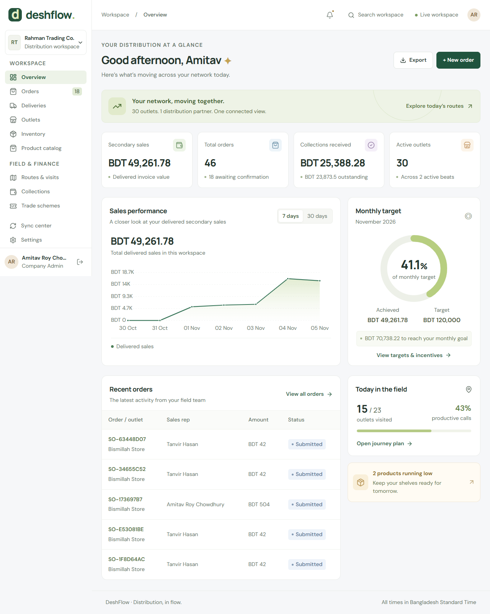

# DeshFlow — FMCG distribution management

A Bangladesh distribution workspace built from [Project_spec.md](Project_spec.md). Next.js App Router + NestJS, PostgreSQL/Prisma, Redis/BullMQ and authenticated Socket.IO.



## Run locally

Requirements: Node 22.12+ (24 recommended), npm, Docker Compose. Run from the repository root:

```powershell
Copy-Item backend/.env.example backend/.env
Copy-Item frontend/.env.example frontend/.env.local
docker compose up -d
npm ci
npm run db:generate
npm run db:migrate
npm run db:seed
npm run dev
```

Open **http://127.0.0.1:3000**. API: localhost:4000/api. PostgreSQL: localhost:5438; Redis: localhost:6397. Docker ports bind to loopback and volumes persist data. `docker compose down` stops services without deleting data.

The seed uses `SEED_PASSWORD` from `backend/.env`. Example value: `ChangeMe!2026`. Set your own before seeding shared environments. Seed skips existing user databases without deleting data.

| Email                  | Role                  |
| ---------------------- | --------------------- |
| admin@fmcg.local       | Company administrator |
| manager@fmcg.local     | Area manager          |
| distributor@fmcg.local | Distributor           |
| sr@fmcg.local          | Sales representative  |
| accounts@fmcg.local    | Accounts              |

Seed: Dhaka Division → Dhaka North → Mirpur; two beats, one distributor, 30 outlets, 20 SKUs, five accounts, promotions, targets, visits, 36 orders and related deliveries/payments. Browser tests create additional demo orders.

## Features

- Actual sales, collections, credit exposure, target and field performance, stock/credit alerts. Dashboard totals include full history; orders support server pagination.
- Territory hierarchy, team accounts, distributors, outlets, beat transfers, credit limits, products and versioned prices.
- Secondary orders with prioritized percent, fixed, free-goods slab and combo schemes.
- Credit approval, allocation, dispatch, delivery, cancellation and backorder flags.
- Primary stock receipts with invoice references and movement ledger.
- Cash/bKash/Nagad/cheque collections, FIFO allocation, cheque reconciliation/bounce.
- Weekly beats, GPS visits and geofence flags.
- Monthly targets, SKU focus, incentive slabs, locked approvals and paid state.
- Delivery claims/return requests with manager review and audit history.
- Per-user offline order/collection outbox, reconnect sync, idempotent UUIDs, visible errors.
- Search/filter, CSV export, audit history and authenticated realtime refresh.

All text starts at **14px**. Responsive phone/tablet/desktop layouts, focus-trapped dialogs, Escape support and reduced-motion animations. SVG labels compensate for scaling.

## Offline and business rules

Sign in and open the workspace online once before disconnecting. Service worker caches shell/static assets; IndexedDB stores scoped snapshots/outboxes. Orders/collections queue offline; GPS visits need connectivity. Use separate browser profiles on shared devices.

Reconnect sync preserves UUIDs and retains failed items. Stale prices need a replacement with current prices; credit excess creates `PENDING_APPROVAL`. Cached history retains 500 recent orders/collections; online orders search all history. `/sync/pull` returns a full replacement snapshot; `since` is reserved for future delta optimization.

Money is integer paisa; quantities are integer pieces. Credit includes invoices and reserved orders. Serializable transactions retry conflicts. Schemes use `orderedAt`, including delayed orders up to seven days old. Free goods reserve only available stock.

Allocation reduces stock. Cancellation before dispatch restores paid/free units. Partial invoices charge allocated paid units with proportional discount. Follow-up orders fulfill backorders. Payments cannot exceed unpaid/unreserved balance; cheques allocate after clearing.

Incentives: 80% achievement → 1%, 100% → 2%, 120% → 2.5%, plus BDT 5/productive visit and 1% focus sales. Approved periods lock. Monthly jobs run at 02:00 on the first, Asia/Dhaka. Daily jobs materialize visits and record overdue/low-stock alerts. Redis caches prices and per-user beat snapshots with invalidation.

## Verify

```powershell
npm run typecheck
npm test
$env:RUN_INTEGRATION='1'; npm test; Remove-Item Env:RUN_INTEGRATION
npm run build
npm audit
# With npm run dev in another terminal and Chrome installed:
npm run test:e2e
```

13 unit tests plus one database acceptance test cover schemes, credit, FIFO, incentive slabs, GPS, concurrent duplicates/delivery, territory isolation, partial/free stock, cheque clearing and cancellation restoration. Integration tests create isolated records and clean them up; CI uses a dedicated database. Eight browser tests cover every route, role/origin rejection, orders, mobile/typography, offline sync, GPS and accessibility. Screenshots go to `artifacts/`.

## Deployment and boundaries

Build, then supervise `npm run start -w backend` and `npm run start -w frontend` separately. Apply migrations first. Set unique database/Redis credentials, `JWT_SECRET`, `CORS_ORIGINS`, `API_URL`, `NEXT_PUBLIC_SOCKET_URL`, and HTTPS. Set `BIND_HOST=0.0.0.0` only when containers/proxies require it. Reverse-proxy Socket.IO to the API. HttpOnly/SameSite cookies, origin checks, role/scope checks, validation and login limits run on the API. Public deployments need managed backups and gateway rate limits.

Local implementation is available; production hosting has not been provisioned. The specified stack needs Node hosting with PostgreSQL/Redis access.

Claims are review records: approval does **not** automatically issue credit notes/refunds or restock physical returns. Accounts must settle claims and verify returns through the organization's accounting process. Primary receipts track invoice references/stock movements rather than supplier payment accounting. Payment references are recorded; live payment, SMS, SMTP and S3 integrations are not connected. Optional RETAILER lite is not enabled. Manufacturing/modern trade POS are outside core scope.

See [API](docs/API.md), [architecture](docs/ARCHITECTURE.md), [verification](docs/VERIFICATION.md).
