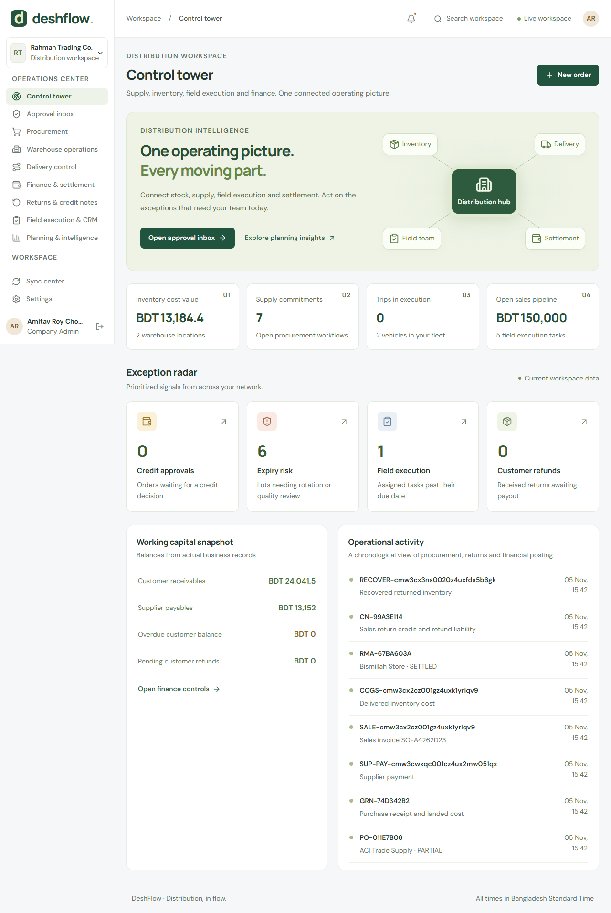

# DeshFlow — advanced FMCG distribution workspace

A Next.js/React frontend and NestJS API for Bangladesh distribution operations. PostgreSQL/Prisma stores transactional data; Redis/BullMQ handles caching and scheduled jobs; Socket.IO refreshes authorized workspaces.



## Two-folder structure

```text
frontend/   Next.js app, UI, PWA, frontend dependencies and lock file
backend/    API, Prisma/migrations, Docker, scripts, tests, docs, CI example
```

Only these two project directories live at the root. Hidden `.git` metadata remains for version control. Each application owns its package.json, package-lock.json and node_modules. There is no root npm workspace.

## Start

Requirements: Node 22.12+ (24 recommended), npm, Docker Compose; Chrome for local browser tests.

From the repository root:

```text
node backend/scripts/setup.mjs
```

The setup helper copies missing environment examples, generates a random JWT secret for a new environment, installs both applications, starts PostgreSQL/Redis, applies migrations and seeds base/advanced demo data. It preserves existing environment files and business data.

Then, from `backend/`:

```text
npm run dev:all
```

Open **http://127.0.0.1:3000**. API: localhost:4000/api, PostgreSQL: localhost:5438, Redis: localhost:6397. Compose keeps the project name `fmcg-distribution-management`, preserving existing volumes after the file move. Stop infrastructure with `docker compose down` from backend; do not use `--volumes` unless intentionally removing data.

For manual setup, run `npm ci` in each folder, copy the two environment examples, then run `docker compose up -d`, `npm run db:generate`, `npm run db:migrate`, `npm run db:seed`, `npm run db:seed:advanced` inside backend.

## Demo access

Use `SEED_PASSWORD` from backend/.env. Example password is `ChangeMe!2026`; change it before seeding any shared environment.

| Account                | Role                                   |
| ---------------------- | -------------------------------------- |
| admin@fmcg.local       | Company administrator                  |
| manager@fmcg.local     | Area manager                           |
| distributor@fmcg.local | Distributor                            |
| sr@fmcg.local          | Sales representative / assigned driver |
| accounts@fmcg.local    | Accounts                               |

Base seed: one territory, two beats, one distributor, 30 outlets, 20 products and sample sales. Advanced seed adds warehouses, suppliers, purchase pipeline, batch receipts, opening journals, fleet, a planned trip, field tasks and opportunities. Seeds are repeatable without deleting existing data. Browser acceptance creates additional demo records.

## Operational modules

- **Control tower:** stock, supply, delivery, working capital, exceptions and activity timeline.
- **Procurement:** suppliers, multi-line purchase orders, manager approval, partial/full GRNs, batch/expiry capture, landed cost, payables and partial supplier payments.
- **Warehouse operations:** multiple locations, FEFO paid/free reservations, quality quarantine, recall propagation, outlet traceability, in-transit stock transfers, physical counts and approved variance adjustments.
- **Sales:** versioned trade prices, percent/fixed/free-goods/combo schemes, credit exposure, overrides, orders, allocation, delivery/invoicing, cancellations and backorders.
- **Delivery control:** vehicles, payload capacity checks, trip planning, geographic stop ordering, driver assignment, dispatch, recipient/POD references, failed attempts and trip closure.
- **Returns:** authorization, quantity validation, physical inspection/receipt, restock/quarantine/scrap, invoice credits, refund liability and refund payment.
- **Finance:** FIFO collections, cheque clearing/bounce, receivables aging, outlet statements, supplier settlement, balanced journals/trial balance, expense approvals/payments and field-cash handover with variance accountability.
- **Field & CRM:** beats/GPS, productive calls, outlet segments/terms, merchandising/audit tasks, evidence-backed checklists, sales opportunity pipeline and monthly incentives.
- **Planning:** demand rate, days of cover, lead/safety stock recommendations, ABC classification and expiry exposure.
- **Data & security:** validated CSV import studio, export/print, approval inbox, audit history, account access changes, password changes and session revocation.

All application text is at least 14px. Responsive layouts, reduced-motion animation, keyboard dialogs and operational search/filter controls are retained.

## Integrity rules

Money is stored in integer paisa; quantities are integer pieces. Serializable transactions retry conflicts, and PostgreSQL checks enforce nonnegative stock and valid invoice/payable/credit balances. Client UUIDs prevent duplicate order, collection, purchase and receipt posting. Collection journals follow invoice allocation per distributor.

Allocation uses available, unexpired batches in FEFO order. Unsafe allocated lots block dispatch/delivery. Transfers remove available stock while in transit. Counts reject stale stock snapshots. Cancellation restores allocated paid/free stock. Expiry removes stock from sellable availability; recalls propagate to derived return/transfer lots.

Returns cannot exceed delivered paid/free quantities. Only paid units create credits. Physical receipt posts stock disposition and credit together. Unpaid invoice balance receives credit first; paid value creates a refund liability. A pending cheque must be cleared/bounced before return credit posting.

Landed costs use integer unit costs; fractional-unit freight residue is posted to `LANDED_COST_ROUNDING`, preserving the full supplier liability. Unknown historical opening cost stays zero and is not represented as an inferred purchase cost.

## Offline

Sign in online once before disconnecting. SR orders/collections are retained in a per-user IndexedDB outbox and reconnect with original UUIDs. Stale price and credit errors stay visible. Offline collections preserve their original collection time. Sync collections before submitting the cash-day handover; late cash requires accounts review after handover.

Advanced purchasing, warehouse changes and settlement require connectivity. Cached sales history contains 500 recent orders/collections; online order search uses server pagination and dashboard totals cover full history.

## Verify and deploy

From backend:

```text
npm run check:all
npm test
npm run build:all
npm run verify
npm run verify:browser
```

`verify` includes database acceptance tests, structure checks, migration/seeds, builds and both dependency audits. `verify:browser` additionally supervises production servers and runs Playwright. A dedicated test database is recommended. If servers are already running, the runner reuses them and does not stop them.

For production, apply migrations and supervise `npm run start` in each application folder. Configure strong secrets, database/Redis access, HTTPS, allowed origins, API/socket URLs, backups and gateway limits. Set BIND_HOST only when the deployment network requires it. No production hosting or external payment/map/storage/messaging account is provisioned.

GitHub workflow discovery requires a root `.github/workflows`, which conflicts with the two-folder requirement. The workflow is retained as an **external runner example** in `ci/github-actions.example.yml`; automatic root workflow discovery is not active. Use the portable verification runner from your CI service.

[Detailed capabilities and boundaries](docs/ADVANCED_CAPABILITIES.md) · [API](docs/API.md) · [Architecture](docs/ARCHITECTURE.md) · [Verification](docs/VERIFICATION.md) · [Original project specification](docs/Project_spec.md)
