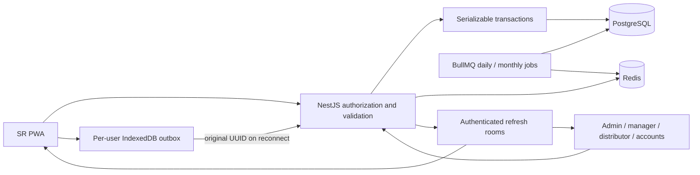

# Architecture

The root contains two standalone applications, frontend and backend, each with its own dependencies and lock file. Next.js proxies `/api` to NestJS and connects to authenticated Socket.IO. PostgreSQL stores business records; Redis stores price/beat caches and BullMQ schedules. Prisma 7 uses a bounded PostgreSQL driver-adapter pool.

Pure rules live in `src/domain`. Services enforce roles, scope and transactions. Reads exclude password hashes; financial changes/approvals create audit records.

Original paid/free quantities differ from allocated quantities. Stock movements explain receipts, allocations and cancellations. Unique deliveries and serialization prevent duplicate invoices. Cheques reserve collectible balance until reconciliation.

Company admins have company scope. Managers/accounts have assigned territories. SR orders are personal, with outlets in their territory. Distributor stock/orders require their own distributor ID. Only admins create users/territories.

The service worker never caches API responses. IndexedDB snapshots/outboxes are scoped by user identity. Cached identity cannot authorize server sync. Separate browser profiles are appropriate on shared devices.

The advanced layer adds procurement, multi-warehouse batches and FEFO allocations, purchase receipts/payables, return authorizations and credit/refund settlement, balanced distribution journals, expenses/cash handover, fleet/trips/POD references, execution checklists, sales opportunities and demand/ABC planning. Journals are immutable through the API and carry stable posting references. Stock and financial balances also have database check constraints.

This is a single-company installation with integer-piece inventory. A full statutory ledger, fractional quantities and multi-company tenancy remain outside scope. Online orders are paginated; offline snapshots retain recent history; dashboard metrics query full history separately. See ADVANCED_CAPABILITIES.md for algorithm, evidence and integration boundaries.
